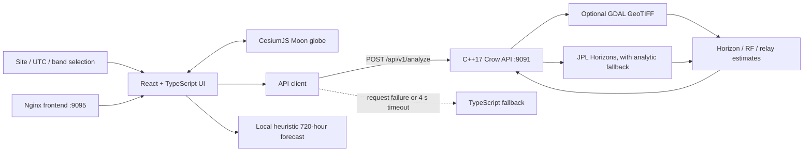
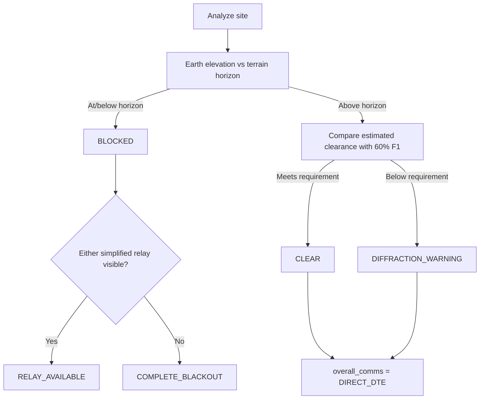

<p align="center">
  
</p>

<h1 align="center">Lunar South Pole Landing Site Navigator</h1>

<p align="center">NASA Space Apps Challenge project · Interactive lunar site analysis and visualization</p>

<p align="center"><a href="https://lunar.andreos.org">Project-reported live app</a> · <a href="https://lunar-api.andreos.org/api/v1/analyze">Project-reported API</a></p>

This repository contains a React/TypeScript and CesiumJS lunar globe plus a C++17 Crow API for experimental site analysis. The backend can sample an operator-supplied GeoTIFF DEM, query JPL Horizons, estimate terrain horizons and radio clearance, and evaluate a simplified relay model. The frontend provides an offline fallback and an analytical time-window forecast.

> **Important:** This is a prototype, not a certified mission-planning or flight-safety tool. Results depend on external data and model assumptions. No LOLA DEM is included in this repository. The frontend/backend RF band labels currently disagree for S and Ka bands; those live results default to X-band until the mismatch is fixed.

## Architecture



The source repository contains the two application services and their Dockerfiles. Public hostnames, Cloudflare Tunnel routing, host port publishing, and container restart policies are deployment configuration—not set up by these Dockerfiles. The public URLs above are project-reported links, not health checks.

### Request flow

```mermaid
sequenceDiagram
  actor User as Operator
  participant UI as React / Cesium
  participant Client as frontend/src/api.ts
  participant API as Crow API
  participant Data as Horizons / GDAL
  User->>UI: Select site, time, and band
  UI->>Client: Debounced analysis request
  Client->>API: POST JSON
  API->>Data: Query ephemerides; sample DEM if loaded
  Data-->>API: Positions and terrain estimates
  API-->>Client: Analysis JSON
  alt Error or client timeout
    Client->>Client: Calculate approximate fallback
  end
  Client-->>UI: Result tagged LIVE or OFFLINE FALLBACK
  UI->>UI: Render telemetry and local forecast
```

## Verified stack and repository layout

| Component | Source-verified implementation |
|---|---|
| Frontend | React, TypeScript, Vite, CesiumJS; Node 20 build stage and Nginx Alpine runtime. Container exposes `9095`. |
| Backend | C++17, Crow, GDAL, libcurl, nlohmann/json; Crow listens on `9091`. |
| Terrain | GDAL reads the path in `DEM_PATH`, default `/data/lunar_dem.tif`. No DEM file is committed. |
| Ephemerides | libcurl calls JPL Horizons with a 4-second HTTP timeout; analytic Sun/Earth calculations are fallback paths. |
| Moon visualization | `Cesium.Ellipsoid.MOON`; frontend radius constant is `1,737,400 m`. NASA Moon Trek WAC imagery URL is configured in `App.tsx`. |
| Logo | Astro Punks image above is present at `frontend/Retro Moon Astro Punks Logo.webp`; the UI separately loads `/logo.png`. |

```text
backend/
  CMakeLists.txt
  Dockerfile
  main.cpp
  gdal_parser.cpp / gdal_parser.h
  jpl_ephemeris.cpp / jpl_ephemeris.h
  radio_comms.cpp / radio_comms.h
frontend/
  Dockerfile
  nginx.conf
  package.json
  public/logo.png
  Retro Moon Astro Punks Logo.webp
  src/App.tsx
  src/api.ts
  src/index.css
  src/main.tsx
```

## Implemented behavior and limits

### API

`POST /api/v1/analyze` accepts a JSON object with `lat`, `lon`, `utc_time`, and `frequency_band`. The backend checks required fields and types, latitude `[-90, 90]`, and longitude `[-180, 360]`. It does not enforce an ISO-8601 format or an allowlist of band strings. Invalid/unparseable UTC may make the ephemeris code use current system UTC. `GET /`, `GET /health`, and `OPTIONS /api/v1/analyze` are also implemented.

Example request:

```json
{
  "lat": -89.9,
  "lon": 0.0,
  "utc_time": "2026-11-14T00:00:00Z",
  "frequency_band": "X_BAND"
}
```

A successful raw backend response contains `site_elevation_m`, `dem_loaded`, `ephemeris_source`, `overall_comms`, and nested `sun`, `earth`, and `relay` fields. `source` (`LIVE` or `OFFLINE FALLBACK`) is added by the frontend client, not the C++ API. `ephemeris_source` identifies the backend ephemeris path, not whether the overall response came from the live API.

### Terrain and ephemerides

- If the DEM cannot be opened, terrain elevation and horizon routines return `0`; those fields are not meaningful terrain measurements. With a loaded DEM, the parser uses GDAL geotransform/projection data, a 2×2 bilinear elevation sample, and great-circle horizon scans. The default horizon scan is 50 km with 100 m steps.
- The backend horizon scan applies a small-angle lunar curvature correction to each sampled height and reports the maximum apparent terrain angle and its distance.
- Horizons is queried separately for Sun and Earth; each can fall back to an analytical model. The response reports `JPL_HORIZONS` if at least one query succeeded, otherwise `ANALYTICAL_FALLBACK`.

### RF and solar classifications (backend)

The backend computes the 60% first Fresnel clearance requirement using the obstacle distance, mean Earth–Moon distance and selected frequency. The clearance calculation is a simplified vertical-angle estimate, not a full RF link budget or diffraction-loss calculation.



- `BLOCKED` means Earth elevation is at or below the terrain horizon. The backend does **not** separately require Earth elevation to be above 0°.
- `CLEAR` and `DIFFRACTION_WARNING` both result in `overall_comms: DIRECT_DTE`. Relay availability is considered when DTE is blocked.
- Solar margin is `Sun elevation - terrain horizon`: `OPTIMAL` at `>= 5°`, `LOW_POWER` at `>= 1.5° and < 5°`, and `CRITICAL_SHADOW` below `1.5°`.
- These are model status labels, not solar-array power, battery, RF link-budget, or mission safety calculations. Frontend fallback thresholds and calculations differ from the backend.

**Band mapping issue:** `frontend/src/api.ts` and the UI send `S_BAND`, `X_BAND`, `KA_BAND`. The C++ engine recognizes `S-BAND` and `KA-BAND`; every other value selects X-band (`8.4 GHz`). Therefore live S/Ka selections currently use X-band. Align these strings before relying on live multi-band results.

### Relay, map, and forecast

- The backend models two deterministic polar circular relay positions named `LCRNS-1` and `Moonlight-1`, with a half-period phase offset. This is not a sourced or mission-validated LunaNet constellation, satellite ephemeris, link budget, or handover model. It checks relay elevation against local terrain horizon and a simplified Moon occultation test.
- The UI draws lunar latitude/longitude graticules, hard-coded crater outlines, a Malapert marker, selected site marker, and Sun/DTE/relay indicator lines. The relay line is schematic, not a computed uplink/downlink trajectory. Crater constants in `App.tsx` are code values; this repository alone does not establish their official provenance or scientific descriptions.
- Preset sites in the frontend: Shackleton Rim `(-89.9, 0.0)`, Malapert Massif `(-86.0, 2.7)`, Haworth PSR `(-87.4, 340.5)`, Connecting Ridge `(-89.4, 222.0)`.
- Forecasting is done in the browser over a fixed interval, **2026-11-14 through 2026-12-14 UTC**, with one-hour samples. It uses simplified harmonic/heuristic horizon and relay formulas; it does not make 720 Horizons or DEM-backed API analyses. Treat its windows and percentages as estimates.

## Build and run

### Backend container

The backend Dockerfile is a single-stage Ubuntu 24.04 image and downloads Crow’s `crow_all.h` at build time. Mount a suitable lunar GeoTIFF if terrain-backed output is needed:

```bash
cd backend
docker build -t lunar-backend .
docker run --rm -p 9091:9091 \
  -v /absolute/path/to/lunar_dem.tif:/data/lunar_dem.tif:ro \
  -e DEM_PATH=/data/lunar_dem.tif \
  lunar-backend
```

Without the mount, the API can start, but DEM-derived values are zero/fallback values. The actual DEM product, resolution, and provenance are determined by the supplied file.

### Frontend container

```bash
cd frontend
docker build -t lunar-frontend .
docker run --rm -p 9095:9095 lunar-frontend
```

The frontend Dockerfile builds with `node:20-alpine` and serves static output using Nginx Alpine. For local development:

```bash
cd frontend
npm install
npm run dev
```

`VITE_CESIUM_ION_TOKEN` is read by the UI. The API URL is hard-coded in `frontend/src/api.ts`; setting `VITE_API_URL` currently has no effect.

## Project-reported context and attribution

The following deployment and process details were supplied as project notes and are not independently proved by this code snapshot: the public app/API hostnames, Cloudflare Tunnel setup, and contributions attributed to Google Gemini, Antigravity Agentic IDE, GitHub Copilot, and human reviewers. Retain the AI-use descriptions only if they accurately reflect your team’s records. The code uses manual CORS header helpers in `backend/main.cpp`, not `crow::CORSHandler`.

The frontend configures a NASA Moon Trek LRO WAC tile URL and labels its imagery credit “NASA LRO WAC.” The backend can query NASA JPL Horizons. The repository does not include LOLA DEM data. Verify planetary-feature names, coordinates, radii, scientific significance, and any NASA/IAU attribution against primary references before presenting them as authoritative.
