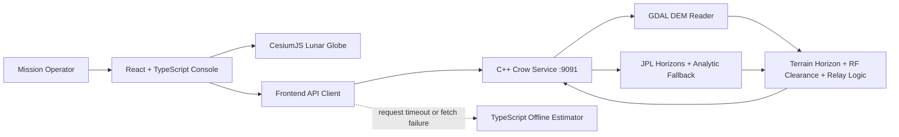
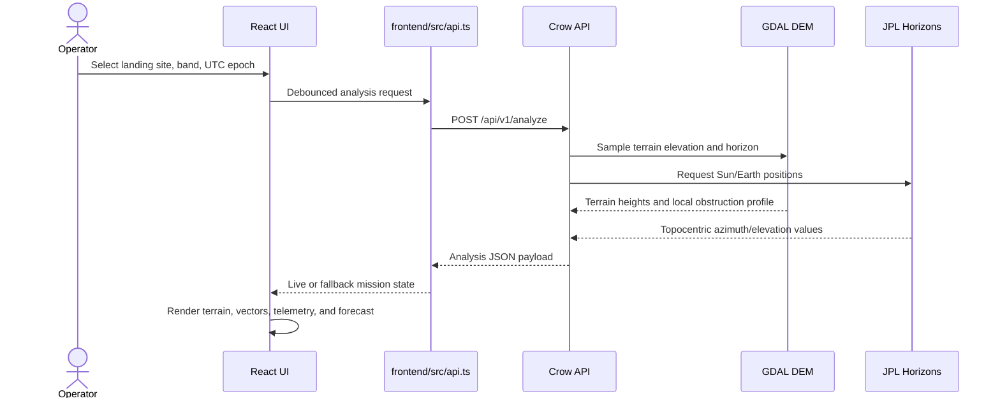

<p align="center">
  
</p>

<h1 align="center">Lunar South Pole Landing Site Navigator</h1>

<p align="center">
  <strong>Mission Analysis Prototype</strong>
  <br />
  Lunar South Pole illumination, terrain obstruction, communications, and landing-site feasibility assessment
</p>

<p align="center">
  <a href="https://lunar.andreos.org">Live application</a>
  ·
  <a href="https://lunar-api.andreos.org/api/v1/analyze">Telemetry API</a>
  ·
  <a href="https://github.com/Agavrile/lunar-navigator">Repository</a>
</p>

## Mission Overview

The Lunar South Pole Landing Site Navigator is a mission-planning and analysis prototype designed to evaluate lunar south-polar landing regions through a compact software stack:

- a React + TypeScript front end for interactive mission visualization,
- a CesiumJS 3D lunar globe for site assessment and map overlays,
- a C++17 Crow API for terrain and communications analysis,
- and a deterministic fallback model for degraded or unavailable live service conditions.

This system is engineered to support operational-style analysis around the lunar south pole, with emphasis on terrain masking, solar illumination conditions, and direct-to-Earth / relay communications viability. The project is intended as a prototype investigation tool and a visualization platform, not as a flight-certified mission-planning system.

> Mission note: all outputs are generated from modeled conditions and are subject to data availability, runtime assumptions, and the accuracy of the terrain DEM and ephemeris inputs used during execution.

## Mission Architecture



## Mission Systems

### Flight-Deck Frontend
- CesiumJS rendering on `Cesium.Ellipsoid.MOON`
- Mission controls for latitude, longitude, UTC epoch, and RF band
- Time scrubber and heuristic 30-day planning windows
- Preset south-pole landing sites and scene overlays

### Analysis Backend
- C++17 service using Crow
- GDAL terrain sampling from a runtime DEM path
- JPL Horizons-based celestial querying with analytical fallback
- Solar elevation, horizon blocking, Fresnel-style clearance, and relay-status classification

### Operational Fallback Layer
When the live API is unavailable or times out, the frontend substitutes a deterministic offline estimator to maintain usability and to approximate mission state for planning workflows.

## Repository Structure

```text
backend/
  CMakeLists.txt
  Dockerfile
  main.cpp
  gdal_parser.cpp / gdal_parser.h
  jpl_ephemeris.cpp / jpl_ephemeris.h
  radio_comms.cpp / radio_comms.h
frontend/
  Dockerfile
  nginx.conf
  package.json
  public/logo.png
  Retro Moon Astro Punks Logo.webp
  src/App.tsx
  src/api.ts
  src/index.css
  src/main.tsx
README.md
```

## Mission Data Flow



## Mission Payload and Analysis Interface

The main API endpoint is:

```http
POST /api/v1/analyze
```

Example request:

```json
{
  "lat": -89.9,
  "lon": 0.0,
  "utc_time": "2026-11-14T00:00:00Z",
  "frequency_band": "X_BAND"
}
```

Required request fields:
- `lat`: numeric in the range `[-90, 90]`
- `lon`: numeric in the range `[-180, 360]`
- `utc_time`: ISO-like UTC timestamp
- `frequency_band`: string identifier for RF band selection

The backend returns a JSON analysis object containing:
- `site_elevation_m`
- `dem_loaded`
- `ephemeris_source`
- `overall_comms`
- nested `sun`, `earth`, and `relay` response blocks

The frontend adds `source` as a client-side property and tags the response as:
- `LIVE`
- `OFFLINE FALLBACK`

## Mission Data Sources and Constraints

### Terrain Data
The terrain engine reads a DEM file from the runtime environment. If no file is mounted, the backend still starts, but terrain-derived quantities are effectively non-meaningful.

The default path is:

```text
/data/lunar_dem.tif
```

The repository does not include the DEM asset itself. The actual terrain fidelity depends entirely on the user-supplied raster data.

### Ephemeris Data
The backend performs live JPL Horizons requests when available and falls back to analytic Sun/Earth models when the request fails or times out.

This gives the system a practical operational mode while preserving a deterministic fallback path.

### RF Band Interpretation
The frontend sends band strings in the form:
- `S_BAND`
- `X_BAND`
- `KA_BAND`

The C++ backend recognizes:
- `S-BAND`
- `KA-BAND`

Any other string falls through to the default `X_BAND` behavior. This mismatch is an implementation detail that should be corrected before using live multi-band comparisons as a mission-grade reference.

## Science and Engineering Model Notes

### Terrain Horizon Logic
The terrain engine estimates local horizon blocking by sampling the DEM and evaluating terrain rise along a directional azimuth. This produces a local obstruction profile and a maximum apparent terrain angle at a given azimuth.

### Solar Illumination Logic
Sun status is derived from:
- Sun elevation relative to local terrain horizon,
- local horizon height,
- and a simplified threshold model for power viability.

The backend uses the following classification logic for solar viability:
- `OPTIMAL` when the net margin is `>= 5°`
- `LOW_POWER` when the net margin is `>= 1.5°` and `< 5°`
- `CRITICAL_SHADOW` otherwise

### Communications Logic
The system evaluates:
- Earth elevation relative to the terrain horizon,
- local obstruction and effective line-of-sight,
- a simplified Fresnel-style clearance threshold,
- and relay visibility as a mission fallback.

Status categories include:
- `CLEAR`
- `DIFFRACTION_WARNING`
- `BLOCKED`
- `DIRECT_DTE`
- `RELAY_AVAILABLE`
- `COMPLETE_BLACKOUT`

These are engineering estimates intended for prototype mission analysis. They are not a replacement for a validated RF engineering model or a certified flight operations assessment.

## Mission Planning and Forecasting

The frontend includes a local 30-day forecast using a fixed time window and heuristic calculations. It is designed to provide a quick glance at likely mission conditions but should be interpreted as a conceptual planning aid, not as a high-fidelity predictor.

The forecast window is generated in-browser and is not computed from a full DEM- or Horizons-backed 720-hour model. It is a deterministic approximation useful for UI demonstration and rapid exploration.

## Local Build and Run

### Backend Container

```bash
cd backend
docker build -t lunar-backend .
docker run --rm -p 9091:9091 \
  -v /absolute/path/to/lunar_dem.tif:/data/lunar_dem.tif:ro \
  -e DEM_PATH=/data/lunar_dem.tif \
  lunar-backend
```

### Frontend Container

```bash
cd frontend
docker build -t lunar-frontend .
docker run --rm -p 9095:9095 lunar-frontend
```

### Local Frontend Development

```bash
cd frontend
npm install
npm run dev
```

## Mission Readiness Statement

This repository is a working prototype and research visualization platform for lunar south-pole mission analysis. It demonstrates:
- lunar terrain-informed site evaluation,
- ephemeris-based lighting analysis,
- comms viability classification,
- and a 3D interactive mission console.

It is not yet a mission-validated engineering product, and any operational use should be preceded by further validation against authoritative scientific and engineering data sources.

## Data and Attribution Notes

- NASA Moon Trek WAC imagery is used in the front-end configuration.
- JPL Horizons is queried for ephemeris information.
- The repository does not include the actual LOLA DEM product.
- Any planetary naming, crater geometry, or scientific narratives included in UI text should be verified against authoritative sources before being treated as mission-grade reference data.

## Summary

The Lunar South Pole Landing Site Navigator provides a compact lunar mission-analysis environment for exploring terrain, lighting, and communications viability on the lunar south pole. It has been designed to be useful as a prototype, a demonstration platform, and a foundation for further mission-analysis development.

The codebase is intentionally modular and operationally transparent:
- data ingestion is isolated,
- analysis logic is centered in the backend,
- and the frontend remains focused on visualization and planning workflows.

This structure supports iteration and validation as the project matures from prototype into a more rigorous mission-analysis tool.
