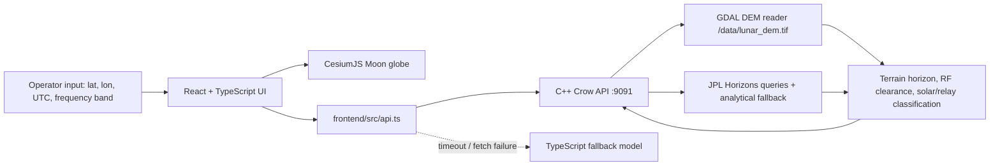

<p align="center">
  
</p>

<h1 align="center">Lunar South Pole Landing Site Navigator</h1>

<p align="center">
  <a href="https://lunar.andreos.org">Live app</a>
  ·
  <a href="https://lunar-api.andreos.org/api/v1/analyze">API endpoint</a>
  ·
  <a href="https://github.com/Agavrile/lunar-navigator">GitHub repo</a>
</p>

A React + TypeScript and CesiumJS mission-planning interface paired with a C++17 Crow backend for lunar south-pole landing-site analysis. The project models terrain obstruction, solar illumination, direct-to-Earth line-of-sight, and a simplified relay fallback around a lunar south-pole landing site.

> Important: this repository contains a prototype analysis tool, not a certified flight-planning or safety-critical system. The backend depends on a DEM file supplied at runtime and the frontend contains heuristic fallback logic.

## Architecture



## Components

### Frontend
- React 18 + TypeScript + Vite
- CesiumJS with `Cesium.Ellipsoid.MOON`
- Lunar UI overlays, crater/rim rendering, and 30-day mission forecast heuristics
- Debounced API calls from `frontend/src/api.ts`

### Backend
- C++17
- Crow REST server
- GDAL DEM parsing
- JPL Horizons HTTP queries with analytical fallback
- Simplified horizon, Fresnel, relay, and overall communications logic

## Repository structure

```text
backend/
  CMakeLists.txt
  Dockerfile
  main.cpp
  gdal_parser.cpp / gdal_parser.h
  jpl_ephemeris.cpp / jpl_ephemeris.h
  radio_comms.cpp / radio_comms.h
frontend/
  Dockerfile
  nginx.conf
  package.json
  public/logo.png
  Retro Moon Astro Punks Logo.webp
  src/App.tsx
  src/api.ts
  src/index.css
  src/main.tsx
README.md
```

## API behavior

The primary endpoint is:

```http
POST /api/v1/analyze
```

Example payload:

```json
{
  "lat": -89.9,
  "lon": 0.0,
  "utc_time": "2026-11-14T00:00:00Z",
  "frequency_band": "X_BAND"
}
```

The backend expects:
- `lat`: numeric in `[-90, 90]`
- `lon`: numeric in `[-180, 360]`
- `utc_time`: ISO-like UTC string
- `frequency_band`: string

The API returns a JSON object with keys like:
- `site_elevation_m`
- `dem_loaded`
- `ephemeris_source`
- `overall_comms`
- nested `sun`, `earth`, and `relay` objects

The frontend client adds a `source` field (`LIVE` or `OFFLINE FALLBACK`) on top of the raw response.

## Important implementation notes

### DEM handling
The backend reads the DEM path from `DEM_PATH` if present; otherwise it defaults to `/data/lunar_dem.tif`.

No DEM file is committed in this repository. If the file is not mounted, DEM-derived fields are effectively non-meaningful and the app falls back to a simplified local model.

### Ephemeris
The backend does live JPL Horizons calls and falls back to analytic lunar Sun/Earth calculations if the request fails or times out.

### Frequency band handling
The C++ backend recognizes `S-BAND` and `KA-BAND`; any other string falls through to the default `X_BAND` case. The frontend sends strings like `S_BAND`, `X_BAND`, and `KA_BAND`.

This means the band strings are currently mismatched between the TypeScript client and the C++ parser; live S/Ka-band values are effectively not being interpreted as the strings implied by the frontend. This is a repo-level implementation detail to be corrected before relying on live multi-band comparisons.

### Relay and forecast models
The backend relay evaluation is a deterministic, lightweight model and not a full LunaNet constellation simulation. The frontend 30-day forecast is a browser-side heuristic and should be treated as an estimate rather than a precise operational forecast.

## Build and run

### Backend

```bash
cd backend
docker build -t lunar-backend .
docker run --rm -p 9091:9091 \
  -v /absolute/path/to/lunar_dem.tif:/data/lunar_dem.tif:ro \
  -e DEM_PATH=/data/lunar_dem.tif \
  lunar-backend
```

### Frontend

```bash
cd frontend
docker build -t lunar-frontend .
docker run --rm -p 9095:9095 lunar-frontend
```

For local development:

```bash
cd frontend
npm install
npm run dev
```

## Notes on data provenance and interpretation

- The frontend references NASA Moon Trek WAC imagery.
- The backend queries JPL Horizons via libcurl.
- The repo does not include the actual LOLA DEM data set.
- The project is designed as a prototype visualization and analysis tool, not a scientific or mission-validation system.

## License and attribution

Project-specific data and model assumptions are embedded in the UI and backend code. The included Moon imagery and orbital/terrain references are used for application context; users should verify any external planetary naming, geodetic, or scientific attribution against the authoritative source material before treating them as mission-grade reference data.

## Summary

This repository contains a working prototype of a lunar south-pole analysis workstation:
- a Cesium-based 3D lunar globe,
- a C++ analysis service,
- per-site terrain and line-of-sight evaluation,
- a simplified relay model,
- and a local forecast UI.

It is well-suited for demo, experimentation, and iterative improvement, but it should not be treated as a final mission-planning system without additional validation, telemetry, and data provenance review.
